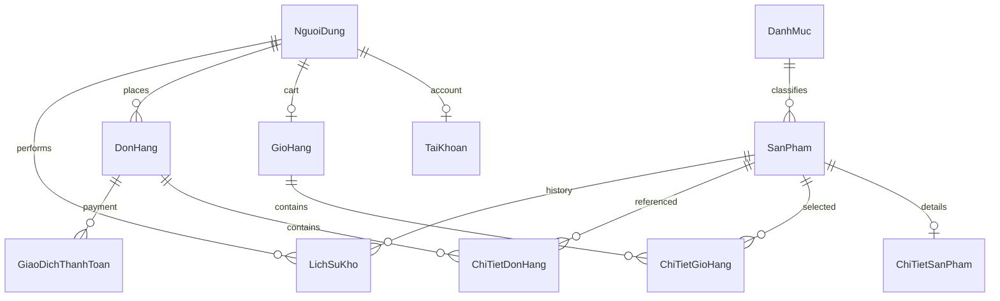

# Schema, quan hệ và truy vấn

Nguồn là mô tả `database.sql`/model trong các báo cáo; không có SQL gốc trong input, không kết nối DB và không chạy câu lệnh.

## Bảng được báo cáo

| Bảng | Vai trò / ràng buộc được ghi nhận |
|---|---|
| `NguoiDung` | PK `MaND`; thông tin người dùng; liên kết account/cart/order/stock history |
| `TaiKhoan` | PK `MaTK`; FK `MaND`; `MaND` và `TenDangNhap` unique theo tài liệu |
| `DanhMuc` | PK `MaDM`; `TenDM` unique; cha của sản phẩm |
| `SanPham` | PK `MaSP`; FK danh mục; có giá/tồn/trạng thái |
| `ChiTietSanPham` | PK `MaCTSP`; FK+UNIQUE `MaSP`, quan hệ tối đa 1:1 |
| `GioHang` | PK `MaGH`; FK+UNIQUE `MaND`, tổng lưu song song |
| `ChiTietGioHang` | PK `MaCTGH`; FK giỏ/sản phẩm; unique `(MaGH, MaSP)` |
| `DonHang` | PK `MaDH`; FK người mua; `MaNV` nullable và được báo cáo tham chiếu `TaiKhoan` |
| `ChiTietDonHang` | PK `MaCTDH`; FK đơn/sản phẩm; `DonGia` snapshot |
| `GiaoDichThanhToan` | PK `MaGD`; FK đơn; có trong schema, chưa thấy flow controller/model dùng |
| `LichSuKho` | PK `MaLS`; FK sản phẩm/người thực hiện; ghi biến động tồn |

Các bảng được mô tả dùng InnoDB, có PK/FK/UNIQUE/CHECK. Khả năng thực thi CHECK tùy MySQL/MariaDB version và chưa xác minh. Cardinality tối thiểu thường không được FK bảo đảm; ví dụ người dùng có thể chưa có giỏ, schema cho phép order không có detail, dù luồng ứng dụng tạo detail cho đơn không rỗng.

## Truy vấn theo model

- `Product`: join `SanPham`/`DanhMuc` INNER, `ChiTietSanPham` LEFT; filter keyword/category, sort allowlist; `featured` có LIMIT, `all` không phân trang.
- `Account`: lookup/login/profile/management; existence checks; create/register/update/status transaction. Email precheck không có unique DB guarantee theo tài liệu.
- `Cart`: get/create, select lines, tính tổng; add có row locks; updateItem check tồn rồi write không lock/transaction; clear dùng hai write không atomic.
- `Order`: COD transaction khóa giỏ/sản phẩm, tính tổng theo giá hiện tại, insert đơn và snapshot giá dòng, giảm stock có điều kiện, ghi `LichSuKho`, clear cart. Hủy transaction hoàn tồn, ghi log và đổi status.

Prepared statements được báo cáo cho values. Không nội suy identifier ngoài sort allowlist. `findForCustomer` lọc theo order ID và owner trước detail lookup. Danh sách order không pagination theo tài liệu.

Chi tiết từng điểm gọi nằm trong [ledger 60 call site](sql_callsite_ledger.md).`n`n## Số liệu SQL

Ledger v4 báo 60 PDO call sites trong 4 model: Account 22, Cart 17, Order 17, Product 4. Một đính chính đếm ghi 54 call sites có chuỗi trực tiếp, 49 mẫu literal chuẩn hóa và 6 call sites dùng biến `$sql`; theo quy ước đó là 55 đơn vị định nghĩa query. Đây là các thước đo khác nhau, không cộng thay thế nhau. Chưa kiểm lại source SQL.

## Rủi ro schema/triển khai

- `database.sql` được báo cáo chứa DROP 11 bảng trước CREATE; đây là schema khởi tạo phá hủy nếu chạy vào DB đang có dữ liệu.
- Migration `20261012_add_customer_address.sql` thêm `DiaChiNhanHang`, nhưng snapshot schema chính được báo cáo đã có cột đó; cần kiểm trạng thái migration trước deploy.
- `dulieuao.sql` là fixture INSERT, không có CREATE TABLE. V4 nêu 20 NguoiDung, 20 TaiKhoan, 10 DanhMuc, 120 SanPham và ChiTietSanPham được sinh bằng INSERT...SELECT; không trích row values.
- Chưa xác minh database runtime, charset, collation, index plan hoặc version.

## Sơ đồ quan hệ khái quát

Sơ đồ là biểu diễn tóm tắt; dùng [ghi chú cardinality v4](../reports/source_traceability.md#database-schema-and-relationships) để hiểu giới hạn constraint so với business rule.

