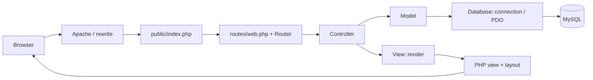

# Kiến trúc hệ thống

> Mô tả tổng hợp từ tài liệu phân tích nguồn. File mã nguồn không có trong thư mục đầu vào nên chi tiết chưa được đối chiếu trực tiếp ở lần tổng hợp này.

## Mô hình xử lý request

Theo tài liệu, front controller nạp cấu hình, autoloader tự viết ánh xạ `App\\` sang `app/`, session, route và exception handler. Router chuẩn hóa method/path, tìm handler theo thứ tự khai báo. Controller kiểm input/quyền và điều phối model/view. Model dùng PDO; view include PHP template bằng output buffering; layout phát HTML và tài nguyên giao diện.

## Phân lớp và phụ thuộc

Đây được mô tả là phân lớp kiểu MVC ở mức ứng dụng, không phải framework MVC đầy đủ. Controller khởi tạo model cụ thể trực tiếp; Database dùng kết nối PDO static singleton. Không thấy DI container/interface trong báo cáo. Cách tổ chức tách được routing, request, persistence và presentation nhưng làm mock/test isolation khó hơn.

## Router và HTTP

- Có 27 khai báo: 13 GET, 14 POST; bốn URL có cả GET và POST: `/register`, `/login`, `/account`, `/checkout`.
- Router dynamic path được báo cáo dùng placeholder `{name}`, match segment không chứa `/`, cho trailing slash tùy chọn và chọn route trùng đầu tiên.
- Router chung trả 404 cho không match, kể cả method sai trên path đã biết; một số action có kiểm tra POST riêng và trả 405.
- URI được parse/decode; cần kiểm tra encoded slash/base path khi thay đổi hoặc triển khai.
- Apache rewrite phụ thuộc mod_rewrite, AllowOverride và DocumentRoot; chưa runtime-test.

## Cấu hình và lỗi

Tài liệu v2 ghi `config/app.php` có `debug => true`, front controller bật `display_errors` trong chế độ debug, và base path có hardcode cần đồng bộ với `base_url`. Đây là rủi ro nếu cấu hình đó được triển khai cho người dùng thật; trạng thái production chưa xác minh. Database config được mô tả là thiết lập local XAMPP; không chép giá trị credential.

## Ranh giới output

`View::render` dùng `extract(..., EXTR_SKIP)` và include layout. Layout in `$content` thô như HTML do view con tạo; vì vậy view con là ranh giới tin cậy và phải encode dữ liệu theo đúng HTML context. Tài liệu v4 báo cáo dynamic values trong 17 view đã được rà có escape/cast/format phù hợp theo ma trận, nhưng đây vẫn là review tĩnh, không phải bảo đảm an toàn runtime.

## Liên quan

- [Module/method reference](source_code/module_and_method_reference.md)
- [Luồng nghiệp vụ và route](business_logic/workflows_and_routes.md)
- [Security analysis](security/security_analysis.md)
